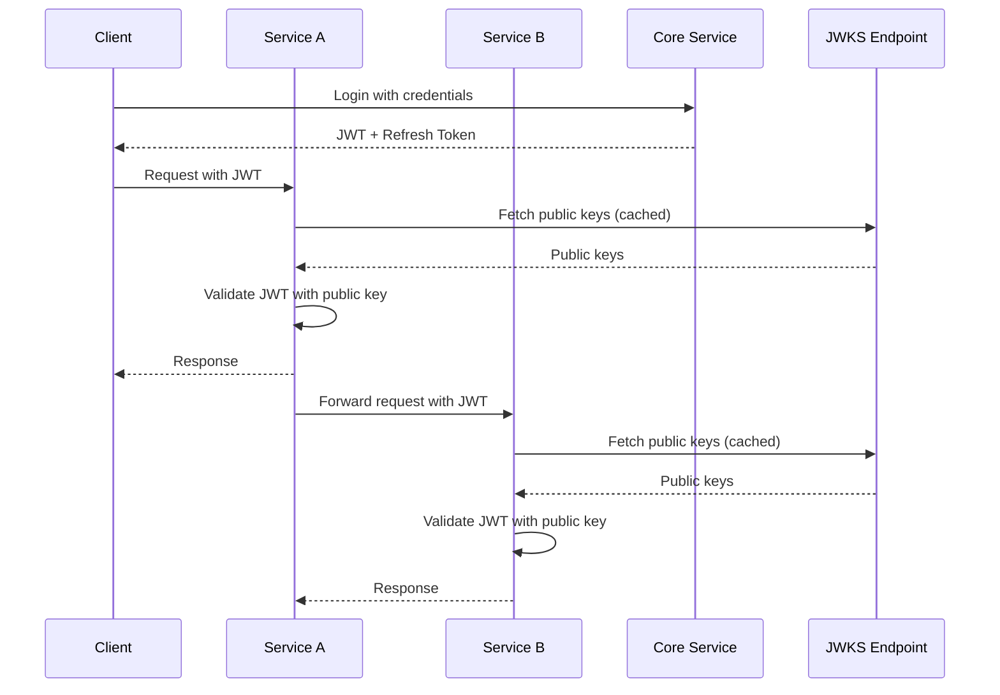

# Authentication API Documentation

## Overview

The MyTorra Core Service implements a zero-trust authentication architecture using JWT tokens with RS256 (RSA with SHA-256) signing. This ensures that services can independently validate tokens without sharing secrets.

## Table of Contents

1. [Public Authentication Endpoints](#public-authentication-endpoints)
2. [JWKS Endpoints](#jwks-endpoints)
3. [Service-to-Service Authentication](#service-to-service-authentication)
4. [RSA Key Rotation and Expiration](#rsa-key-rotation-and-expiration)
5. [Security Best Practices](#security-best-practices)

## Public Authentication Endpoints

### 1. User Login

**Endpoint:** `POST /api/v1/auth/login`

**Request Body:**

```json
{
  "email": "user@example.com",
  "password": "SecurePassword123!",
  "mfa_code": "123456" // Optional, required if MFA is enabled
}
```

**Response:**

```json
{
  "access_token": "eyJhbGciOiJSUzI1NiIsInR5cCI6IkpXVCIsImtpZCI6ImtleV9pZCJ9...",
  "refresh_token": "opaque_secure_token_32_bytes",
  "expires_in": 900, // 15 minutes in seconds
  "user": {
    "id": "uuid",
    "email": "user@example.com",
    "name": "John Doe",
    "area_id": "uuid",
    "verification_level": 2,
    "status": "active"
  }
}
```

### 2. Token Refresh

**Endpoint:** `POST /api/v1/auth/refresh`

**Request Body:**

```json
{
  "refresh_token": "opaque_secure_token_32_bytes"
}
```

**Response:**

```json
{
  "access_token": "eyJhbGciOiJSUzI1NiIsInR5cCI6IkpXVCIsImtpZCI6ImtleV9pZCJ9...",
  "refresh_token": "same_or_rotated_refresh_token",
  "expires_in": 900
}
```

### 3. User Registration

**Endpoint:** `POST /api/v1/auth/register`

**Request Body:**

```json
{
  "email": "newuser@example.com",
  "phone": "+1234567890",
  "password": "SecurePassword123!",
  "confirm_password": "SecurePassword123!",
  "name": "Jane Doe",
  "area_id": "uuid",
  "accept_terms": true
}
```

### 4. Logout

**Endpoint:** `POST /api/v1/auth/logout`

**Headers:**

```
Authorization: Bearer {access_token}
```

**Response:**

```json
{
  "message": "Successfully logged out"
}
```

## JWKS Endpoints

### 1. JSON Web Key Set (JWKS)

**Endpoint:** `GET /.well-known/jwks.json`

**Description:** Returns the public keys in JWKS format for JWT verification.

**Response:**

```json
{
  "keys": [
    {
      "kty": "RSA",
      "use": "sig",
      "kid": "dl_gq3N7G0Io1BFrnbV11w",
      "alg": "RS256",
      "n": "xGOr-H7A-PWG3v0aoYTg...", // RSA modulus
      "e": "AQAB" // RSA exponent
    }
  ]
}
```

**Cache Control:** Public, max-age=3600 (1 hour)

### 2. Public Key (PEM Format)

**Endpoint:** `GET /.well-known/public-key`

**Description:** Returns the current active public key in PEM format.

**Response:**

```
-----BEGIN PUBLIC KEY-----
MIIBIjANBgkqhkiG9w0BAQEFAAOCAQ8AMIIBCgKCAQEAxGOr+H7A+PWG3v0aoYTg
...
-----END PUBLIC KEY-----
```

**Headers:**

```
Content-Type: application/x-pem-file
X-Key-ID: dl_gq3N7G0Io1BFrnbV11w
Cache-Control: public, max-age=3600
```

### 3. Key Information

**Endpoint:** `GET /.well-known/keys/info`

**Description:** Returns metadata about all JWT keys without the actual keys.

**Response:**

```json
{
  "keys": [
    {
      "kid": "dl_gq3N7G0Io1BFrnbV11w",
      "alg": "RS256",
      "use": "sig",
      "created_at": "2025-09-01T07:00:00Z",
      "expires_at": "2025-10-01T07:00:00Z",
      "is_active": true
    }
  ],
  "total": 3,
  "active": 1,
  "expires_in": 2592000 // seconds until next key expires
}
```

## Service-to-Service Authentication

### How It Works

1. **Token Validation:** Services validate JWT tokens independently using public keys from the JWKS endpoint
2. **Zero Trust:** No shared secrets between services
3. **Key Distribution:** Public keys are cached and refreshed periodically

### Implementation Guide for Services

#### 1. Fetch JWKS on Startup

```go
// Example in Go
func fetchJWKS() (*JWKS, error) {
    resp, err := http.Get("https://core-service/.well-known/jwks.json")
    if err != nil {
        return nil, err
    }
    defer resp.Body.Close()

    var jwks JWKS
    if err := json.NewDecoder(resp.Body).Decode(&jwks); err != nil {
        return nil, err
    }

    return &jwks, nil
}
```

#### 2. Validate Incoming Tokens

```go
func validateToken(tokenString string, jwks *JWKS) (*jwt.Token, error) {
    // Parse token to get key ID
    token, err := jwt.Parse(tokenString, func(token *jwt.Token) (interface{}, error) {
        // Get the key ID from token header
        kid, ok := token.Header["kid"].(string)
        if !ok {
            return nil, errors.New("missing key ID")
        }

        // Find the corresponding public key
        publicKey := jwks.GetKeyByID(kid)
        if publicKey == nil {
            return nil, errors.New("key not found")
        }

        return publicKey, nil
    })

    if err != nil || !token.Valid {
        return nil, errors.New("invalid token")
    }

    return token, nil
}
```

#### 3. Cache and Refresh JWKS

```go
type JWKSCache struct {
    jwks      *JWKS
    fetchedAt time.Time
    ttl       time.Duration
    mu        sync.RWMutex
}

func (c *JWKSCache) GetJWKS() (*JWKS, error) {
    c.mu.RLock()
    if time.Since(c.fetchedAt) < c.ttl {
        defer c.mu.RUnlock()
        return c.jwks, nil
    }
    c.mu.RUnlock()

    // Refresh JWKS
    c.mu.Lock()
    defer c.mu.Unlock()

    jwks, err := fetchJWKS()
    if err != nil {
        return c.jwks, err // Return cached version on error
    }

    c.jwks = jwks
    c.fetchedAt = time.Now()
    return jwks, nil
}
```

### Service Authentication Flow



## RSA Key Rotation and Expiration

### Automatic Key Rotation

The system implements automatic RSA key rotation to maintain security:

1. **Key Lifecycle:**

   - Keys are valid for 30 days by default
   - New keys are generated before expiration
   - Multiple keys can be active simultaneously during rotation

2. **Rotation Process:**

   ```
   Day 0:   Key A (active) - expires Day 30
   Day 25:  Key B (active) - expires Day 55
            Key A (active) - expires Day 30
   Day 30:  Key B (active) - expires Day 55
            Key A (expired, still validated)
   Day 35:  Key B (active) - expires Day 55
            Key A (deleted)
   ```

3. **Grace Period:**
   - Expired keys remain valid for 5 days after expiration
   - This allows tokens signed with old keys to remain valid
   - After grace period, old keys are deleted

### Handling Key Expiration

#### 1. Key Management Service

The `KeyManagementService` handles automatic rotation:

```go
// Runs periodically (e.g., daily)
func (s *KeyManagementService) RotateKeysIfNeeded(ctx context.Context) error {
    activeKey, err := s.jwtKeyRepo.FindActiveKey(ctx)
    if err != nil {
        return s.GenerateNewKeyPair(ctx) // No active key, generate one
    }

    // Check if key expires within 5 days
    daysUntilExpiry := time.Until(activeKey.ExpiresAt).Hours() / 24
    if daysUntilExpiry <= 5 {
        return s.RotateKeys(ctx)
    }

    return nil
}
```

#### 2. Cleanup Process

```go
func (s *KeyManagementService) CleanupExpiredKeys(ctx context.Context) error {
    // Deactivate keys past expiration
    deactivated, err := s.jwtKeyRepo.DeactivateExpired(ctx)
    if err != nil {
        return err
    }

    // Delete keys older than 90 days (well past grace period)
    deleted, err := s.jwtKeyRepo.DeleteOldKeys(ctx, 90*24*time.Hour)
    if err != nil {
        return err
    }

    s.logger.Info("Cleaned up keys",
        "deactivated", deactivated,
        "deleted", deleted)

    return nil
}
```

#### 3. Scheduled Tasks

Set up cron jobs or scheduled tasks:

```go
// In main.go or scheduler
func setupKeyRotationScheduler(keyService *KeyManagementService) {
    ticker := time.NewTicker(24 * time.Hour) // Daily
    go func() {
        for range ticker.C {
            ctx := context.Background()

            // Rotate if needed
            if err := keyService.RotateKeysIfNeeded(ctx); err != nil {
                log.Error("Failed to rotate keys", err)
            }

            // Cleanup old keys
            if err := keyService.CleanupExpiredKeys(ctx); err != nil {
                log.Error("Failed to cleanup keys", err)
            }
        }
    }()
}
```

### Manual Key Rotation

For emergency situations or security incidents:

```bash
# Admin endpoint (protected)
POST /admin/keys/rotate

# Response
{
  "message": "Key rotation initiated",
  "new_key_id": "z-uDDVRCGtPCq7QnrlSg0A",
  "expires_at": "2025-10-01T07:00:00Z"
}
```

### Monitoring Key Health

```bash
# Check key status
GET /.well-known/keys/info

# Alert if:
# - No active keys
# - Key expires within 24 hours without replacement
# - Too many keys (possible rotation failure)
```

## Security Best Practices

### 1. Token Lifetimes

- **Access Tokens:** 15 minutes (short-lived)
- **Refresh Tokens:** 30 days (long-lived, opaque)
- **RSA Keys:** 30 days with 5-day grace period

### 2. Key Storage

- Private keys stored encrypted in database
- Public keys cached in memory and Redis
- Never expose private keys via API

### 3. Token Validation

- Always validate token signature
- Check token expiration
- Verify issuer claim
- Validate audience if used

### 4. Refresh Token Security

- Store as bcrypt hash in database
- Use cryptographically secure random generation
- Track device and IP information
- Implement refresh token rotation for high-security environments

### 5. Service Communication

- Always use HTTPS
- Implement request signing for service-to-service calls
- Use mutual TLS for additional security
- Rate limit authentication endpoints

### 6. Monitoring and Alerts

- Monitor failed authentication attempts
- Alert on unusual key rotation patterns
- Track refresh token usage patterns
- Log all key management operations

## Error Handling

### Common Error Responses

```json
{
  "error": {
    "code": "INVALID_TOKEN",
    "message": "The provided token is invalid or expired",
    "details": "Token expired at 2025-09-01T07:00:00Z"
  }
}
```

### Error Codes

- `INVALID_CREDENTIALS`: Invalid email/password
- `INVALID_TOKEN`: Token validation failed
- `TOKEN_EXPIRED`: Token has expired
- `MISSING_TOKEN`: No token provided
- `INVALID_KEY_ID`: Unknown key ID in token
- `ACCOUNT_SUSPENDED`: User account is suspended
- `MFA_REQUIRED`: Multi-factor authentication required

## Migration Guide

For services migrating from HS256 to RS256:

1. Update token validation to use public keys
2. Remove shared secrets from configuration
3. Implement JWKS fetching and caching
4. Update monitoring for new endpoints
5. Test with both old and new tokens during transition
